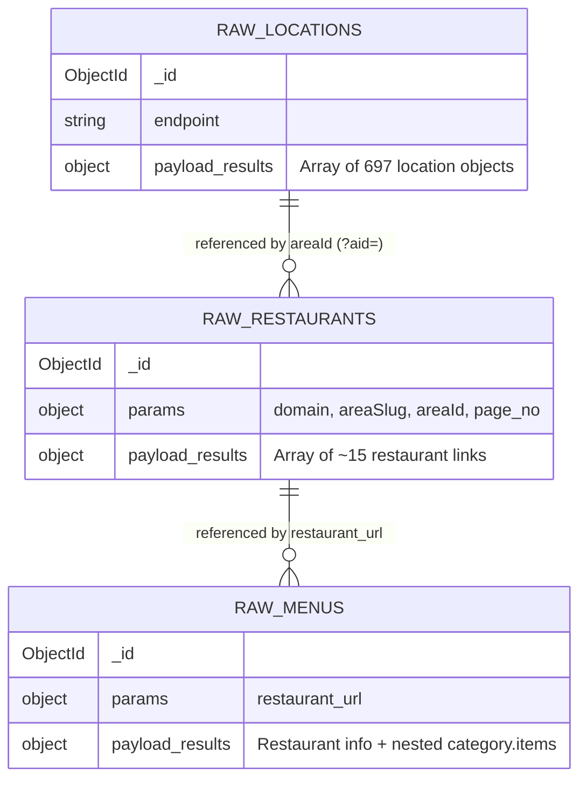
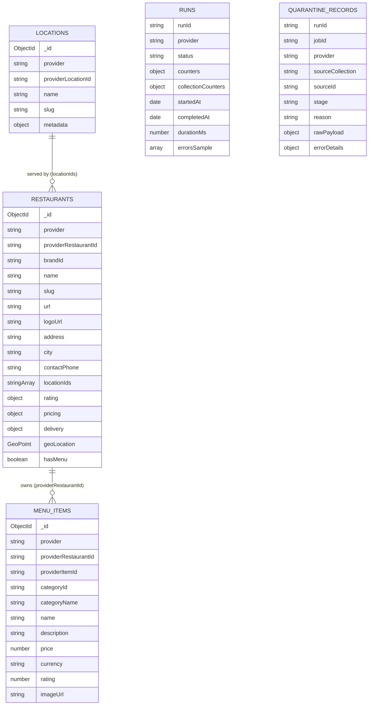
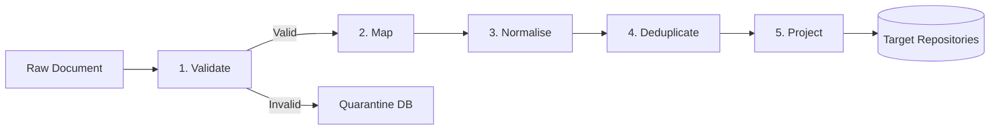
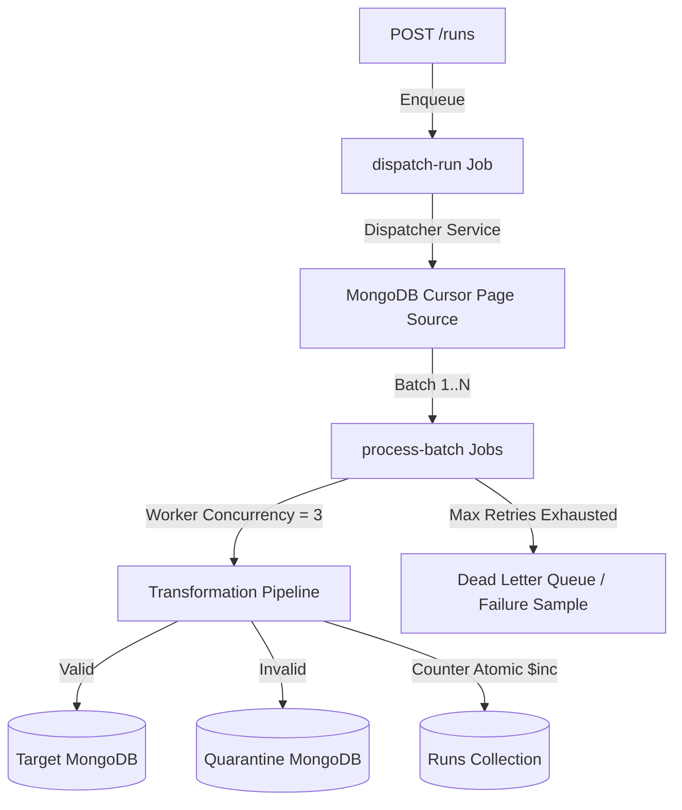

# Architecture & Data Modelling Document

**Service**: Sharkhood Tech Provider Data Factory  
**Author**: Muhammad Aziz Khan (Backend Engineer Mid-Senior Assessment)  
**Date**: October 2026  
**Stack**: NestJS 11 · MongoDB · Redis · BullMQ · TypeScript · Zod  

---

## 1. Source Data Analysis & Relationships

The factory ingests three raw collections exported from a third-party scraper provider (`xbyteapi`) targeting food delivery reference data (Talabat UAE):



### 1.1 Source Collection Shapes

1. **`raw_locations` (`compero-xbyte.xbyte-raw-locations.json`)**
   - Each MongoDB document contains an HTTP response payload with an array `payload.results` of 697 location entries:
     ```json
     {
       "location_name": "Dubai World Trade Center - DWTC",
       "location_slug": "dubai-world-trade-center-dwtc",
       "location_id": 1280
     }
     ```
   - Purpose: Reference directory of delivery zones and areas across the UAE.

2. **`raw_restaurants` (`compero-xbyte.xbyte-raw-restaurants.json`)**
   - Represents paginated area searches with query parameters: `{ domain: "talabat", areaSlug: "al-zaab", areaId: "1468", page_no: 0 }`.
   - Each page document contains `payload.results` (~15 items) listing restaurants serving that area:
     ```json
     {
       "area_name": "Al Zaab",
       "restaurant_name": "Sla Restaurant and Cafe",
       "restaurant_url": "https://www.talabat.com/uae/restaurant/648607/sla-restaurant-and-cafe-al-rowdah?aid=1468"
     }
     ```
   - Key Relationship: `params.areaId` and URL query parameter `?aid=1468` map directly to `location_id` in `raw_locations`.

3. **`raw_menus` (`compero-xbyte.xbyte-raw-menus.json`)**
   - Represents detailed scrape attempts for a specific restaurant menu URL (`params.restaurant_url`).
   - When successful (345 documents), contains a single-element array `payload.results[0]` with full restaurant header attributes (`id`, `outletCode`, `name`, `logo`, `latitude`, `longitude`, `rate`, `totalReviews`, `totalRatings`, `deliveryFee`, `DeliveryTime`, `Minimum Order`, `Restaurant Address`, `City`, `Contact`) and a deeply nested `category` array containing menu sections and `items`.

---

## 2. Anomalies Found in the Source Data

Our exploratory analysis across the sample datasets uncovered several critical data quality anomalies:

| Anomaly Type | Manifestation in Raw Data | Impact & Pipeline Treatment |
|---|---|---|
| **High Scraper Failure Rate (31%)** | In `raw_menus`, 155 out of 500 documents contain no restaurant data: `{"payload": {"Message": "This is not restaurant page (Talabat)."}}`. | Caught at the `ValidationStep` boundary; quarantined to `quarantine_records` with reason `"This is not restaurant page (Talabat)."` rather than throwing uncaught errors or silently dropping. |
| **Scraper & Pagination Limits** | In `raw_restaurants`, some documents contain: `{"Total Page": 1, "Page Error Message": "Page limit exceeded.", "results": []}` or `{"error": ""}`. | Boundary Zod schemas detect empty/error payloads and route them to quarantine without breaking the batch. |
| **Multiple Snapshot Duplication** | In `raw_locations`, the 8 documents in the file are identical recurring snapshots of the same 697 locations (5,576 records for 697 unique locations). | Handled by `DeduplicationStep` in-memory and idempotent `upsertMany` using MongoDB compound unique index `(provider, providerLocationId)`. |
| **Type Drift & Numeric Formatting** | `latitude` and `longitude` are strings (`"25.2167399..."`). `deliveryFee` is sometimes a string (`"9"`), sometimes numeric. `Minimum Order` has mixed types. | `NormalizationStep` safely parses floats and integers, validates geographic boundaries `[-90, 90]` / `[-180, 180]`, and filters dummy coordinates like `(0, 0)`. |
| **Inconsistent Field Naming & Casing** | Keys with spaces (`"Minimum Order"`, `"Restaurant Address"`), PascalCase (`"DeliveryTime"`, `"City"`, `"Contact"`), mixed with snake_case (`outletCode`, `totalReviews`). | Abstracted behind provider-specific declarative mapping (`TALABAT_MENU_DETAIL_FIELD_MAP`). |
| **Buried Nested Entities** | Menu items are buried 3 levels deep: `payload.results[0] -> category[i] -> items[j]`. | Extracted and promoted into first-class `DomainMenuItem` records referencing `providerRestaurantId` and `categoryId`. |
| **Identity Ambiguity (Brand vs Outlet)** | In `raw_menus`, `id` is the Talabat brand/chain ID (e.g. `1400`), while `outletCode` (e.g. `34807`) is the branch/outlet ID matching the URL path `.../restaurant/34807/...`. | Defined natural key on `(provider, outletCode || restaurantId)` while preserving `brandId` as an optional secondary reference. |
| **Dirty Contact Numbers** | Phone numbers often contain dummy placeholders like `"00000-00000"`. | Filtered during normalization to `undefined`. |

---

## 3. Target Domain Model & Honest Trade-off Analysis

### 3.1 Target Collections



### 3.2 Indexing Strategy & Rationales

1. **`locations`**:
   - `{ provider: 1, providerLocationId: 1 }` (Unique): Guarantees multi-tenant provider idempotency.
   - `{ slug: 1 }`: Enables fast URL routing and slug lookups.

2. **`restaurants`**:
   - `{ provider: 1, providerRestaurantId: 1 }` (Unique): Natural key ensuring duplicate page runs never duplicate branches.
   - `{ "geoLocation": "2dsphere" }`: Supports geospatial radius queries (`$near`, `$geoWithin`) for finding nearby restaurants.
   - `{ city: 1, name: 1 }`: Supports fast faceted filtering by city and name search.
   - `{ locationIds: 1 }`: Multikey index allowing instant lookups of all restaurants serving a given area ID.

3. **`menu_items`**:
   - `{ provider: 1, providerRestaurantId: 1, providerItemId: 1 }` (Unique): Stable identity preventing item duplication.
   - `{ provider: 1, providerRestaurantId: 1, categoryId: 1 }`: High-performance index for loading restaurant menus grouped by category.

4. **`runs`**:
   - `{ runId: 1 }` (Unique): Run tracking.
   - `{ status: 1, createdAt: -1 }`: Monitoring active and recent pipeline executions.

5. **`quarantine_records`**:
   - `{ runId: 1, createdAt: -1 }`: Efficient paginated quarantine queries for `GET /runs/:id/errors`.
   - `{ provider: 1, sourceCollection: 1 }`: Auditing data quality by source collection.

### 3.3 Trade-off Analysis: Embedding vs. Referencing

| Decision | Chosen Approach | Alternative Considered | Rationale & Trade-off |
|---|---|---|---|
| **Menu Items Storage** | **Referenced Collection (`menu_items`)** | Embedding categories & items inside the `restaurants` document | **Honest Rationale**: Large restaurants have 200–500 items with descriptions and modifiers. Embedding creates huge documents (approaching MongoDB's 16MB limit) and causes document growth / reallocation churn during frequent price updates. Promoting to a dedicated collection gives items independent lifecycles (pricing, availability, dish search).<br>**Trade-off Accepted**: Retrieving a full restaurant page requires an additional indexed query on `menu_items`. This is offset by compound indexing `{ provider: 1, providerRestaurantId: 1, categoryId: 1 }`. |
| **Restaurant Locations** | **Embedded Array (`locationIds: string[]`)** | Many-to-many join collection (`restaurant_delivery_zones`) | **Honest Rationale**: A restaurant typically delivers to 1–10 adjacent delivery zones. Storing an array of string IDs directly on the restaurant document is compact, read-optimized, and directly queryable via MongoDB multikey indexes.<br>**Trade-off Accepted**: Renaming an area slug does not cascade automatically, but `locationIds` are stable numeric provider IDs, minimizing drift. |
| **Restaurant Geo Location** | **GeoJSON Point (`geoLocation`)** | Separate `latitude` and `longitude` numeric fields | **Honest Rationale**: Allows native geospatial indexing (`2dsphere`) and fast distance calculations in MongoDB.<br>**Trade-off Accepted**: Records without valid coordinates omit the field so the index remains clean. |

---

## 4. The Transformation Pipeline



### 4.1 Pipeline Stage Contracts

1. **Validation (`ValidationStep`)**: Boundary validation using Zod schemas. Checks HTTP 200 status, payload structure, and catches scraper error messages (`"This is not restaurant page (Talabat)."`). Fails fast to quarantine with an explicit reason.
2. **Mapping (`MappingStep`)**: Extracts items from payload results and applies provider-specific declarative mapping (`TALABAT_LOCATION_FIELD_MAP`, etc.) to generate canonical field names.
3. **Normalization (`NormalizationStep`)**: Pure functions standardizing strings, numeric money amounts, phone numbers, delivery intervals, and GeoJSON coordinates.
4. **Deduplication (`DeduplicationStep`)**: Eliminates intra-batch duplicates by hashing natural keys `(provider, providerId)`.
5. **Projection (`ProjectionStep`)**: Projects clean data into target domain interfaces (`DomainLocation`, `DomainRestaurant`, `DomainMenuItem`).

### 4.2 Multi-Provider Extensibility Seam

Adding a second provider (e.g. `Deliveroo`, `UberEats`, `Careem`) requires:
1. Creating `<provider>.adapter.ts` implementing `IProviderAdapter`.
2. Defining `<provider>.mapping.ts` and `<provider>.validation.ts`.
3. Registering the adapter with `ProviderRegistry.register()`.

The core pipeline runner, BullMQ orchestration, repositories, and controllers remain completely untouched.

---

## 5. Queue Topology & Orchestration (BullMQ)



### 5.1 Concurrency & Backoff Strategy
- **Concurrency**: Configurable (default `3`, configurable up to 20 via `QUEUE_CONCURRENCY`).
- **Retries**: 3 attempts with exponential backoff (`delay: 2000ms`, doubling on each attempt).
- **Transient vs Fatal Error Separation**:
  - Malformed documents are quarantined immediately at `ValidationStep` and do not fail the job.
  - Network/database dropouts trigger BullMQ exponential retries.
  - Fatal unrecoverable job errors move to dead-letter status and are recorded in the run's `errorsSample`.

### 5.2 Idempotency & Resumability Guarantees
- **Natural Keys**: Target entities use deterministic natural keys `(provider, providerId)`.
- **Bulk Upserts**: Writing uses `bulkWrite` with `updateOne` and `{ upsert: true }`. Running the factory multiple times on the same raw dataset produces the exact same state with zero duplicate records and zero drift.
- **Worker Crash Recovery**: If a worker crashes mid-batch, BullMQ detects the stalled lock and reassigns the job to another worker. Because writes are idempotent, the re-executed batch finishes cleanly without data duplication.
